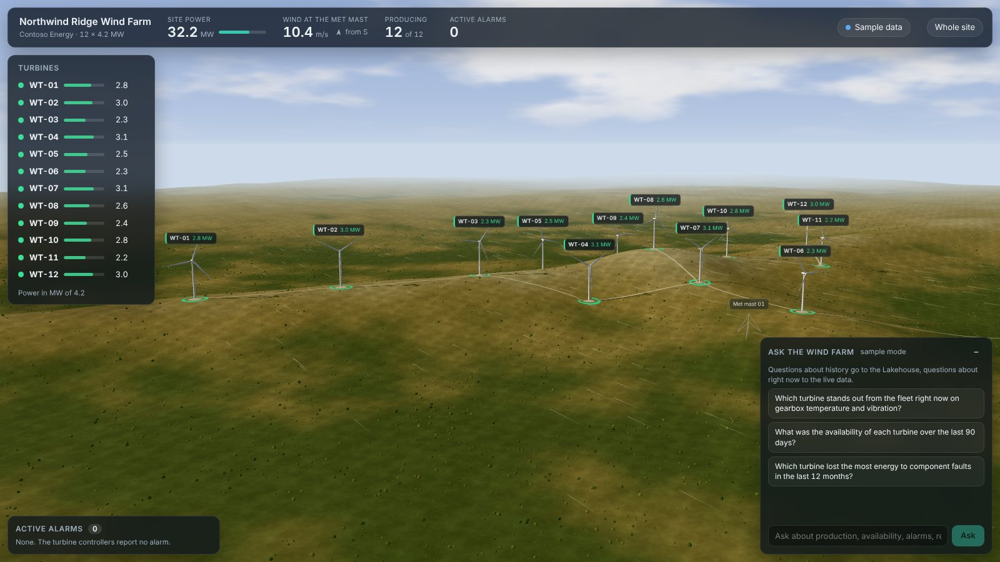

# The wind farm twin (Phase 4)

A Fabric app, built with Rayfin, that shows Northwind Ridge in 3D on live data and lets you ask the data agent questions. The deployment guide is [docs/11-deployment-guide-phase4.md](../docs/11-deployment-guide-phase4.md).

To look at it right now, without Fabric and without installing anything, open `preview/windfarm-twin-preview.html` in a browser. It runs on simulated values. Select a turbine, then **Simulate a gearbox fault**.



## What is in this folder

| Path | What it is |
|---|---|
| `preview/windfarm-twin-preview.html` | The twin with its sample data in one file. No server, no network |
| `create-app.sh` | Creates the app in `windfarm-twin/`: Microsoft's template at a pinned version, its functions pack, then the files of `overlay/` |
| `overlay/packages/frontend/src/App.tsx` | Replaces the welcome screen of the template with the twin |
| `overlay/packages/frontend/src/twin/` | The twin: `scene/` (Three.js), `ui/` (panels and chat), `data/` (where the values come from) |
| `overlay/packages/functions/src/` | The four functions that run in Fabric as the identity of the app |
| `test/`, `package.json`, `build-preview.mjs`, `screenshots.mjs` | The workbench: tests of the code above, the preview build, pictures of the preview |
| `windfarm-twin/` | The app itself. It appears when you run `create-app.sh`; commit it with the rest |

The repository holds the overlay and not the whole app because the rest is Microsoft's template, which changes with every release of Rayfin. The script takes it from the scaffolder at the version the overlay was checked against (2.0.1).

## How the twin gets its values

```text
browser: React + Three.js              Fabric app: functions (TypeScript)          Fabric
  TwinApp ── every 5 s ──────────────► getLiveState ── KQL ──────────────────────► KQL database WindFarmEH
  turbine panel ─────────────────────► getTurbineTrend ── KQL ───────────────────► KQL database WindFarmEH
  chat ──────────────────────────────► askAgent ── Model Context Protocol ───────► data agent WindFarmDataAgent
  connection check ──────────────────► getDiagnostics ── tries each of the above
```

- No token reaches the browser. The functions get theirs from the platform: one for the Fabric API, one for the Eventhouse.
- The functions find the workspace, the KQL database and the data agent by name (`functions/src/config.ts`). No identifier is configured.
- `?sample` at the end of the app's address shows the simulation instead: useful when the edge VM is off.
- `?fullquality` keeps the full picture. Without it the twin lowers its picture quality by itself when frames take longer than 55 ms, which happens on a computer without a graphics card and over a remote desktop.

## What the picture means

| You see | It means |
|---|---|
| A rotor turning | The reported rotor speed, in real time: 12 rpm is one turn in five seconds |
| A nacelle turned away from its neighbours | Its reported direction. WT-05 stands about 9 degrees off: its wind vane is not calibrated |
| Blades turned edge-on to the wind | The turbine is not producing: stopped, idle, in maintenance or in fault |
| Ring on the ground | The state: green running, amber derated, blue curtailed or maintenance, grey stopped, red and pulsing fault |
| Nacelle amber or red | Gearbox vibration past 4.0 or 5.5 mm/s, or oil past 72 °C: the thresholds of the operations agent of Phase 3 |
| White strokes in the air | The wind at the met mast: direction, and longer and faster with more wind |

Two things are not to scale, on purpose: heights of the ground are drawn 2.5 times taller, and turbines 1.8 times larger. Positions are true.

## The workbench

```bash
cd app
npm install          # with npm 10.9.9 this stopped with an error here; npm 12 worked
npm test             # 42 tests: site data, simulation, the functions against stand-ins for Fabric
npm run typecheck
npm run preview      # rebuilds preview/windfarm-twin-preview.html
npm install --no-save playwright && npm run screenshots   # pictures of the preview, needs Chrome
```

The tests run the function code against stand-ins: a pretend Fabric API, a pretend Eventhouse, and the reference server of the Model Context Protocol SDK in the place of the data agent. They show that the code does what it should with the answers it expects. They cannot show that Fabric gives those answers; the connection check in the app does that after deployment.
