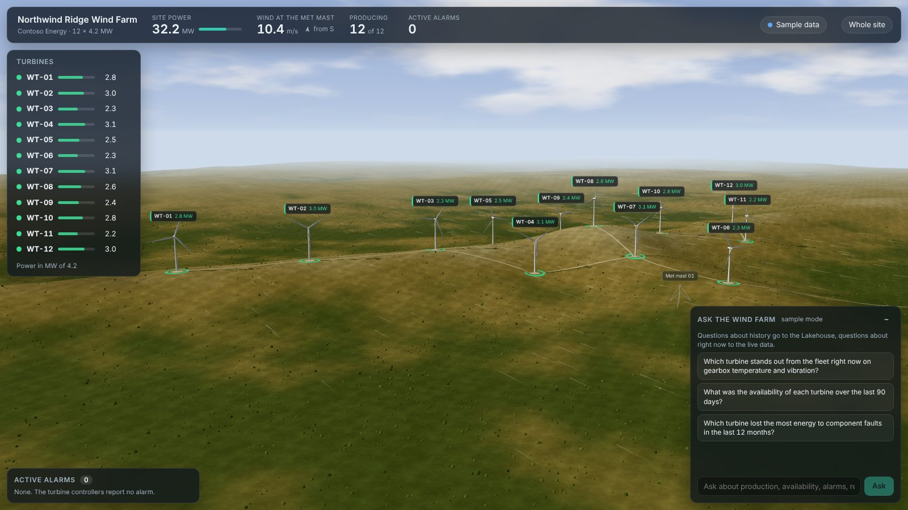
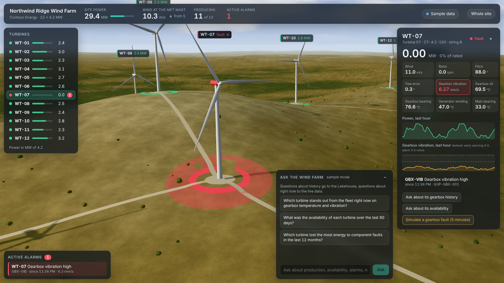

# Deployment guide, Phase 4: the wind farm twin as a Fabric app

Phase 4 puts the wind farm on screen: a 3D view of Northwind Ridge in which every rotor turns at its reported speed, with the live values of each turbine beside it and a chat that sends questions to the data agent of Phase 3. It runs as a Fabric app in the workspace, behind the Fabric sign-in.

**Status of this guide.** Written on 21 November 2026. **Nothing in it has been deployed to Fabric yet.** The twin itself runs: you can open it now on simulated values (step 0). The parts that talk to Fabric were compiled against the released Rayfin packages and tested against stand-ins, and three things can only be found out in Fabric. The first deployment is built to find them out in one go, through the connection check of step 6. [What was and was not tested](#what-was-and-was-not-tested) has the exact list; [phase4-validation-log.md](phase4-validation-log.md) is the record. When a step does not match what you see, send me the screen or the error.

## Contents

- [What you get](#what-you-get)
- [Step 0: Look at it first](#step-0-look-at-it-first)
- [Before you start](#before-you-start)
- [Step 1: Tenant setting](#step-1-tenant-setting)
- [Step 2: Node.js on the workstation](#step-2-nodejs-on-the-workstation)
- [Step 3: Create the app](#step-3-create-the-app)
- [Step 4: Sign in and deploy](#step-4-sign-in-and-deploy)
- [Step 5: Open the app](#step-5-open-the-app)
- [Step 6: Connection check](#step-6-connection-check)
- [Step 7: Show it](#step-7-show-it)
- [After a change](#after-a-change)
- [Design decisions](#design-decisions)
- [What was and was not tested](#what-was-and-was-not-tested)
- [If something fails](#if-something-fails)
- [Remove Phase 4](#remove-phase-4)

## What you get

| Item | Where | What it is |
|---|---|---|
| Fabric app **WindFarmTwin** | Workspace | The twin: a React and Three.js page hosted by Fabric, and four functions that run in Fabric as the identity of the app |
| Function `getLiveState` | Inside the app | Newest row of every turbine, active alarms and the met mast, from the KQL database. The page asks every 5 seconds |
| Function `getTurbineTrend` | Inside the app | One turbine minute by minute, for the panel of that turbine |
| Function `askAgent` | Inside the app | Sends one question to the published data agent **WindFarmDataAgent** and returns its answer |
| Function `getDiagnostics` | Inside the app | Tries every connection the app needs and reports each: the connection check |
| `fabric/kql/94-twin-app-queries.kql` | Repository | The four queries the functions run, to run by hand |
| `app/preview/windfarm-twin-preview.html` | Repository | The twin on simulated values, in one file |

The app creates no table and stores nothing. It reads what Phases 1 and 3 built.

## Step 0: Look at it first

**[Workstation]** Open `app/preview/windfarm-twin-preview.html` in a browser (from WSL: `explorer.exe app/preview` and double-click the file). It needs no server and no network.

- Drag to turn the view, scroll to zoom, select a turbine in the scene or in the list.
- In the panel of a turbine, select **Simulate a gearbox fault**. Over the next two and a half minutes the nacelle turns amber and then red, the turbine is derated, an alarm appears, the turbine trips with its blades feathered, and after five minutes it runs again.
- The badge at the top right says **Sample data**. Every number is invented by the page.





This is the picture you get in Fabric, with real values in the place of the invented ones. If you do not like the picture, tell me now: it is cheaper to change before the deployment than after.

Two things are not to scale, on purpose: the ground is drawn 2.5 times taller than it is and the turbines 1.8 times larger. Positions are true. [app/README.md](../app/README.md) says what each thing in the picture means.

## Before you start

- Phases 1 and 3 are deployed, and the simulator runs: `TurbineTelemetry | where Timestamp > ago(2m) | count` in the KQL database gives a number above zero. Phase 2 is not needed.
- The workspace is on a Fabric capacity (paid or trial). A Power BI Pro workspace cannot run the functions of an app.
- You deploy with the account that built Phases 1 to 3. The app reads the KQL database and asks the data agent **as its owner**, which is the account that deploys it. That account must have access to both.
- A Fabric administrator can change a tenant setting (step 1).
- Node.js 22.13 or newer on the workstation (step 2).
- The repository copy is current: `changes-phase4.zip` unpacked inside WSL, then `bash tools/check-scripts.sh`.

Time: about 30 minutes, most of it waiting for `npm` and for the first deployment.

One thing to know before you share the app with anyone: every person the app is shared with sees the live values and gets the data agent's answers with the rights of the owner, not with their own. Share it with people who may see what you see.

## Step 1: Tenant setting

**[Fabric]** Admin portal, **Tenant settings**, search for "Fabric Apps". Turn **Fabric Apps** on, for the organization or for a security group you are in. Microsoft says the change can take a few minutes.

**Check.** In the workspace, **New item**: an item named **App** is offered. It may still carry the word preview.

Leave **Enforce a strict content security policy for static-hosted Fabric Apps (preview)** as it is. The twin loads nothing from outside its own address and uses no WebAssembly, so it should run with the policy on; that was not tested.

## Step 2: Node.js on the workstation

**[Workstation]**

```bash
node --version    # v22.13.0 or newer
npm --version     # 11 or newer is safer
```

If Node.js is missing or older, install the current LTS. With `nvm`: `nvm install --lts`, then open a new terminal.

If `npm` is 10.x: `npm install -g npm@latest`. With npm 10.9.9 the install of the Rayfin template stopped here with `Cannot read properties of null (reading 'edgesOut')`; npm 12.2.3 installed the same template without complaint.

Do not use `sudo` for anything in this guide.

## Step 3: Create the app

**[Workstation]** From the repository folder:

```bash
bash app/create-app.sh
```

What it does, in this order:

1. Checks Node.js and npm.
2. Runs Microsoft's scaffolder at a pinned version, `@microsoft/create-rayfin@2.0.1`, with the default template (`blankapp`, the Universal App). It creates `app/windfarm-twin` and installs its packages. If it asks a question, accept what it proposes.
3. Adds the functions pack of the template: `npm run pack:add -- functions`.
4. Copies `app/overlay` over the result: the twin, its panels, the four functions.
5. Adds three.js to the frontend.
6. Runs `npm run typecheck` in the app. That runs the template's own validator on the functions and the TypeScript compiler on every package.

**Check.** The last lines are:

```text
The app is ready in windfarm-twin. It has not been deployed. Next, from that folder:
```

The script can be run again. It keeps an existing `app/windfarm-twin`, adds nothing twice and copies the overlay again.

I could not run the scaffolder where I work, so step 2 of this list has not run anywhere yet. I built and checked the app from the template files inside the released CLI package, which are what the scaffolder copies. If the script stops in step 2 or 3, send me what it printed.

## Step 4: Sign in and deploy

**[Workstation]**

```bash
cd app/windfarm-twin
npx rayfin login
npx rayfin up --workspace WindFarmDigitalTwin --item-name WindFarmTwin
```

- `npx rayfin login` opens the browser on Windows. Choose the account of step "Before you start". If it ends with `Can't reach Microsoft Entra ID`, see [If something fails](#if-something-fails).
- `npx rayfin up` builds the page and the functions, creates the Fabric app item and uploads both. It ends by printing the address of the app. The template sets the page to `protected`: only a signed-in person with permission on the app can load it. If the command asks about that, keep protected.
- To see what it would do without doing it: `npx rayfin up -n --workspace WindFarmDigitalTwin`.

**Check.** The workspace shows an item **WindFarmTwin** of type App. `rayfin/.deployments.json` in the app folder records it; later `npx rayfin up` needs no options.

Send me the output of `npx rayfin up` whatever it says. It is the first time this app meets the service, and two parts of it are new to me: how the deployment treats the token declared for the Eventhouse (a "custom audience"), and what the first run asks.

## Step 5: Open the app

**[Fabric]** Open **WindFarmTwin** in the workspace, or the address `npx rayfin up` printed. Sign in when asked.

**Check.**

| You see | It means |
|---|---|
| The site in 3D, twelve rotors turning, **Live · 3 s ago** at the top right | Everything works. Go to step 6 anyway |
| The site in 3D, turbines grey and still, **Not connected** and a red message | The page runs and the functions do not reach the data. Step 6 says why |
| **No telemetry in the last 10 minutes** | The app reads the database, and the database gets nothing: the edge VM or the simulator is stopped. `./infra/vm.sh status` |
| **Stale · last value 3 min ago** | As above, but it stopped within the last 10 minutes |
| A white page or "Couldn't sign you in" | The page did not start. Open the browser's developer tools, **Console**, and send me the red lines |

Add `?sample` to the address to see the twin on simulated values at any time.

## Step 6: Connection check

**[Fabric]** In the app, select the badge at the top right (**Live**, **Not connected**, whatever it says). The dialog runs `getDiagnostics` and lists six lines. Select **Copy the result** and send it to me.

| Line | PASS means | If it fails |
|---|---|---|
| Token for the Fabric API | The platform gave the function a token for `api.fabric.microsoft.com` | The functions are not deployed with application authentication. Send me the line |
| Token for the Eventhouse | The platform gave the function a token for `https://kusto.kusto.windows.net` | Not a problem by itself: see the two query lines |
| Workspace and KQL database | The identity of the app found the workspace `WindFarmDigitalTwin` and the address of `WindFarmEH` | "sees N workspaces and none is named…": the owner of the app has no role in the workspace. Deploy with the account that has |
| Data agent | An item `WindFarmDataAgent` exists in the workspace | Run notebook 09 of Phase 3 |
| Query with the Eventhouse token | The KQL database answered a count of the last two minutes | See below |
| Query with the Fabric token | The same query with the other token | See below |

The app needs **one** of the two query lines to pass. It tries the Eventhouse token first and falls back to the Fabric token by itself.

- **Both pass, or one passes:** the live values work. Tell me which, so that the guide can say it.
- **Both fail:** the twin has no live values. Send me both lines: the Eventhouse says in them why it refused. Until that is solved, show the twin with `?sample`; the chat does not depend on this and may work.

Then ask one question in the chat that needs the live data, and one that needs the history:

- `What is every turbine doing right now?`
- `What was the availability of each turbine over the last 90 days?`

Expect half a minute or more per answer. If the first fails and the second works, tell me: Microsoft documents that a service principal cannot yet use a data agent that has a KQL database among its sources, and this would show that the identity of the app counts as one.

## Step 7: Show it

**The small fault of Phase 3, now with a picture.**

**[Workstation]**

```bash
./infra/vm.sh ssh bash ./edge/scripts/inject-anomaly.sh WT-03 gearbox_degradation 0.2 30m
```

| Minutes after the command | In the twin |
|---|---|
| 1 to 5 | The nacelle of WT-03 turns amber and an amber halo appears on the ground: vibration has passed 4.0 mm/s. In the list WT-03 gets an amber mark. No alarm: the controller's limit is 5.5 |
| any time | Select WT-03: the vibration tile is amber, and the trend of the last hour shows the climb towards the dashed line |
| 5 to 12 | The Teams message of the operations agent arrives. The twin showed the same thing first, because it looks every 5 seconds and the agent every 5 minutes |
| 30 | The fault ramps out; the nacelle turns white again |

Then, in the panel of WT-03, select **Ask about its gearbox history**. The question goes to the data agent, which answers from the Lakehouse.

**The full fault.** The runbook of Phase 1 ([02-demo-runbook.md](02-demo-runbook.md)) injects severity 0.8 on WT-07. In the twin: nacelle red within a minute, alarm in the list and in the alarm panel, the ring amber when the turbine is derated and red and pulsing when it trips, the rotor stopped with the blades turned edge-on.

**Questions for the chat.** The three it proposes, and from Phase 3: `Which turbine lost the most energy to component faults in the last 12 months?`, `Has WT-03 had gearbox problems before?`. The agent is the one of Phase 3 and no better: try a question before you show it.

## After a change

| What changed | Do |
|---|---|
| The repository, after merging an update | `bash app/create-app.sh --overlay`, then in `app/windfarm-twin`: `npm run typecheck` and `npx rayfin up` |
| Only the page (anything under `packages/frontend`) | `npx rayfin up staticapp deploy` |
| Only the functions | `npx rayfin up functions deploy`. Wait two minutes between two deployments of functions: the service refuses a second one sooner |
| A function was added, removed or its parameters changed | `packages/functions/src/types.ts` must say the same. `npm run typecheck` tells you when it does not |

## Design decisions

**Functions, not connectors.** Rayfin 2.0.1 knows a connector type for an Eventhouse and one for a Fabric data agent, and holds both back: the CLI refuses to add either ("authoring is held in this release"). So the app reaches both through functions, which are generally available. When the connectors are released, `getLiveState` and `askAgent` are the two places to change.

**The data agent is asked through its MCP address.** That is what the Rayfin template's own guidance for data agents says to use, with the words "Do not substitute the legacy OpenAI-style endpoint". The function speaks the protocol itself in the order that guidance gives; a test runs it against the reference server of the protocol's SDK.

**Two tokens for the Eventhouse, tried in order.** A function gets tokens from the platform for the resources it declares. The Eventhouse is not on the built-in list, so the app declares its resource, `https://kusto.kusto.windows.net`, as a custom audience. Whether the platform issues that token to the identity of an app, I could not find out without deploying. So the function also tries the Fabric token, remembers which one worked, and the connection check shows both.

**Items are found by name.** The functions look up the workspace, the KQL database and the data agent by the names of the guides, once every ten minutes. Nothing has to be configured, and nothing breaks when an item is recreated.

**Every function returns JSON text.** Rayfin generates a file of types from the functions, but only in development mode, not at deployment, and the template refuses to build when that file disagrees with the code. With text as the only return type the file is four lines that I could write by hand in the generated form and check with the template's validator.

**No answer while the agent works.** Functions cannot stream, and stop after 240 seconds. The chat shows how long the agent has been working. The author of the original demo used a separate container app for this reason; this demo stays inside Fabric.

**The scene is drawn, not loaded.** Terrain from the heightmap of the reference data, roads from the GIS layer, turbines from the dimensions of the turbine model, sky and ground texture computed in the page. The app ships no image and no model file, and asks no other server for anything.

**The picture adapts to the computer.** When frames take longer than 55 ms the twin lowers its quality in three steps. In a browser without a graphics card a frame of the full picture took more than a second.

## What was and was not tested

**Run, without Fabric**

| What | How | Result |
|---|---|---|
| The twin: scene, panels, simulation, fault story | Headless Chrome on the preview, five pictures looked at; no error in the console | Works. Rendered in software, so slowly |
| The page inside Microsoft's template | Template files of `@microsoft/rayfin-cli@2.0.1`, functions pack applied with the template's own script, overlay copied, `npm run typecheck`, `vite build`, the template's lint rules | All pass. The built page is 1.03 MB of script |
| The functions against the released packages | Compiled against `@microsoft/fabric-user-data-functions@2.0.1`, including the custom audience; the template's validator: 4 authored, 4 generated | Pass |
| The logic of the functions | 42 tests: a pretend Fabric API and Eventhouse; token fallback; database name fallback; what gets into a query; eight deliberate mistakes, all caught | Pass |
| The MCP client in `askAgent` | Against the reference server of `@modelcontextprotocol/sdk` 1.32, answering as JSON and as an event stream | Pass |
| The four KQL queries | Syntax, with the Kusto language service; column names against the table definitions | Pass |
| `app/create-app.sh` | 11 scenarios with stand-ins for node, npm and npx | Pass |

**Not run, because it needs Fabric**

- `npx rayfin login` and `npx rayfin up`: the deployment itself, and what it does with a custom audience.
- Whether the platform gives a function a token for the Eventhouse, and whether the Eventhouse accepts that token or the Fabric one. Step 6 shows it.
- `askAgent` against the real data agent: whether the Fabric token of the app is accepted, and whether the agent's own protocol matches the reference server.
- The four queries against the real database. They use only tables and functions of Phase 1.
- The page behind the real sign-in, and inside the Fabric portal.

**Not run at all**

- The scaffolder `@microsoft/create-rayfin`. The app was put together from the template files in the CLI package instead.
- The app with the strict content security policy turned on.
- A browser with a graphics card. The frame times I measured are of a software renderer.

## If something fails

| Symptom | Cause and fix |
|---|---|
| `create-app.sh`: `Node.js … is too old` | Step 2 |
| `npm`: `Cannot read properties of null (reading 'edgesOut')` | npm 10. `npm install -g npm@latest`, then run the script again |
| `create-app.sh` stops after the scaffolder or the functions pack | Send me what it printed. To go on by hand: the three commands are in the script |
| `create-app.sh`: `The check failed` | The template changed under the overlay, or a file was edited. Send me the lines above the message |
| `npx rayfin login`: `Can't reach Microsoft Entra ID` (WSL) | A VPN or Global Secure Access on Windows. Rayfin's guide: put `[wsl2]`, `networkingMode=nat`, `dnsTunneling=false` into `%UserProfile%\.wslconfig`, run `wsl --shutdown`, try again. Or, in PowerShell: `az account get-access-token --resource https://api.fabric.microsoft.com --query accessToken --output tsv`, and in WSL `export RAYFIN_TOKEN="…"` before `npx rayfin up` |
| `npx rayfin login` complains about the keychain | WSL has no credential store. `export RAYFIN_ENCRYPTION_FALLBACK_ENABLED=true` lets Rayfin keep the sign-in in a plain file under `~/.rayfin`. Its documentation calls that a setting for development only |
| `npx rayfin up` refuses the audience `https://kusto.kusto.windows.net` | Send me the message. To deploy without it: in `packages/functions/src/function_app.ts` remove ` \| 'https://kusto.kusto.windows.net'` from the three annotations and make `kustoToken` throw, as it does in `askAgent`. The app then uses the Fabric token only |
| `npx rayfin up`: the item or the functions cannot be created | Tenant setting of step 1 off, or the workspace is on Power BI Pro |
| The app opens for you and not for a colleague | Share the app item with them: **Run and interact** |
| **Not connected** | Step 6 |
| The chat: "did not answer within 225 seconds" | The agent took too long. Ask a narrower question |
| The chat: "answered 401" or "answered 403" | The identity of the app may not use the data agent. Send me the message |
| The twin is slow or coarse | No graphics acceleration: a virtual machine or a remote desktop. Open the app in a browser on the computer in front of you. `?fullquality` forces the full picture |
| A turbine is grey, the others turn | That turbine sent nothing in the last 10 minutes |

## Remove Phase 4

Delete the item **WindFarmTwin** in the workspace; Fabric removes what belongs to it. On the workstation, delete the folder `app/windfarm-twin`. Nothing else was created.
