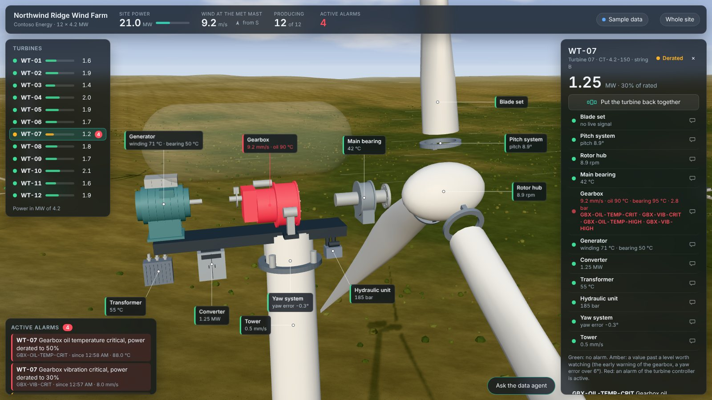

# Deployment guide, Phase 4: the wind farm twin as a Fabric app

Phase 4 puts the wind farm on screen: a 3D view of Northwind Ridge in which every rotor turns at its reported speed, with the live values of each turbine beside it and a chat that sends questions to the data agent of Phase 3. It runs as a Fabric app in the workspace, behind the Fabric sign-in.

**Status of this guide.** Written on 21 November 2026 and first deployed on 23 November 2026. That deployment answered the open question about the live values: **a Fabric app cannot read the Eventhouse directly.** The token made for it is issued only to an app that runs as its own identity, and a Fabric app runs as its owner; the token for the Fabric API is refused by the Eventhouse with 401. So the twin now has two routes for its live values, described in [How the live values reach the app](#how-the-live-values-reach-the-app): through the Lakehouse, which needs nothing and is minutes old, and through a service principal, which you set up in step 7 and which is seconds old. **Neither of the two new routes has been run in Fabric yet**; both are compiled against the released packages and tested against stand-ins. [What was and was not tested](#what-was-and-was-not-tested) has the exact list; [phase4-validation-log.md](phase4-validation-log.md) is the record, with the six obstacles of the first deployment. When a step does not match what you see, send me the screen or the error.

## Contents

- [What you get](#what-you-get)
- [Step 0: Look at it first](#step-0-look-at-it-first)
- [Before you start](#before-you-start)
- [Step 1: Tenant setting](#step-1-tenant-setting)
- [Step 2: Node.js on the workstation](#step-2-nodejs-on-the-workstation)
- [Step 3: Create the app](#step-3-create-the-app)
- [Step 4: Sign in and deploy](#step-4-sign-in-and-deploy)
- [Step 5: Open the app](#step-5-open-the-app)
- [Step 6: Connection check](#step-6-connection-check)
- [Step 7: Real-time values: the service principal](#step-7-real-time-values-the-service-principal)
- [Step 8: Show it](#step-8-show-it)
- [After a change](#after-a-change)
- [How the live values reach the app](#how-the-live-values-reach-the-app)
- [Design decisions](#design-decisions)
- [What was and was not tested](#what-was-and-was-not-tested)
- [If something fails](#if-something-fails)
- [Remove Phase 4](#remove-phase-4)

## What you get

| Item | Where | What it is |
|---|---|---|
| Fabric app **WindFarmTwin** | Workspace | The twin: a React and Three.js page hosted by Fabric, and seven functions that run in Fabric as the identity of the app. The page shows the site, each turbine, and each turbine taken apart into its components |
| Functions `getLiveState`, `getLiveStateLakehouse` | Inside the app | Newest row of every turbine, active alarms and the met mast. The first reads the KQL database as a service principal (seconds old; the page asks every 5 seconds). The second reads the copies of the same tables in the Lakehouse as the owner of the app (minutes old; the page asks every 30 seconds) |
| Functions `getTurbineTrend`, `getTurbineTrendLakehouse` | Inside the app | One turbine minute by minute, for the panel of that turbine, by the same two routes |
| Function `askAgent` | Inside the app | Sends one question to the published data agent **WindFarmDataAgent** and returns its answer |
| Functions `getDiagnostics`, `getDiagnosticsLakehouse` | Inside the app | Try what each route needs and report every step: the connection check |
| `fabric/kql/94-twin-app-queries.kql`, `fabric/sql/94-twin-app-queries.sql` | Repository | The queries the functions run, in KQL for the Eventhouse and in T-SQL for the Lakehouse, to run by hand |
| `app/create-principal.sh` | Repository | Sets up the service principal of step 7, shows it, removes it |
| `app/preview/windfarm-twin-preview.html` | Repository | The twin on simulated values, in one file |

The app creates no table and stores nothing. It reads what Phases 1 and 3 built. Step 7, which is optional, creates one app registration in Microsoft Entra ID and gives it the Viewer role on the workspace.

## Step 0: Look at it first

**[Workstation]** Open `app/preview/windfarm-twin-preview.html` in a browser (from WSL: `explorer.exe app/preview` and double-click the file). It needs no server and no network.

- Drag to turn the view, scroll to zoom, select a turbine in the scene or in the list.
- In the panel of a turbine, select **Exploded view: take the turbine apart**. The cover of the nacelle lifts off, and the turbine comes apart into its eleven components, each with its live values on a label. Point at a part or at a row of the list in the panel; hide the chat (the dash at its top right) to give the parts more room; **Put the turbine back together** or Esc closes it.
- In the panel of a turbine, select **Simulate a gearbox fault**, with the turbine open or closed. The nacelle turns amber after 26 seconds and red after 42, when the first alarm comes. After 68 seconds the turbine is derated to 30% of its rated power, after two and a half minutes it trips with its blades feathered, a minute later it starts again, and after five minutes all is as before. In the exploded view the gearbox takes the colour, and its row lists the alarms.
- The badge at the top right says **Sample data**. Every number is invented by the page. The alarms are the ones of the alarm catalogue; [app/README.md](../app/README.md) has the sequence.





This is the picture you get in Fabric, with real values in the place of the invented ones. If you do not like the picture, tell me now: it is cheaper to change before the deployment than after.

Two things are not to scale, on purpose: the ground is drawn 2.5 times taller than it is and the turbines 1.8 times larger. Positions are true. [app/README.md](../app/README.md) says what each thing in the picture means.

## Before you start

- Phases 1 and 3 are deployed, and the simulator runs: `TurbineTelemetry | where Timestamp > ago(2m) | count` in the KQL database gives a number above zero. Phase 2 is not needed.
- The workspace is on a Fabric capacity (paid or trial). A Power BI Pro workspace cannot run the functions of an app.
- You deploy with the account that built Phases 1 to 3. The app reads the KQL database and asks the data agent **as its owner**, which is the account that deploys it. That account must have access to both.
- A Fabric administrator can change a tenant setting (step 1).
- Node.js 22 on the workstation, 22.13 or newer (step 2 installs it).
- The repository copy is current: `changes-phase4.zip` and then `changes-phase4-update1.zip` unpacked inside WSL, then `bash tools/check-scripts.sh`.

Time: about 30 minutes, most of it waiting for `npm` and for the first deployment.

One thing to know before you share the app with anyone: every person the app is shared with sees the live values and gets the data agent's answers with the rights of the owner, not with their own. Share it with people who may see what you see.

## Step 1: Tenant setting

**[Fabric]** Admin portal, **Tenant settings**, search for "Fabric Apps". Turn **Fabric Apps** on, for the organization or for a security group you are in. Microsoft says the change can take a few minutes.

**Check.** In the workspace, **New item**: an item named **App** is offered. It may still carry the word preview.

Leave **Enforce a strict content security policy for static-hosted Fabric Apps (preview)** as it is. The twin loads nothing from outside its own address and uses no WebAssembly, so it should run with the policy on; that was not tested.

## Step 2: Node.js on the workstation

**[Workstation]**

```bash
node --version
npm --version
```

You are done with this step if the first line prints `v22.` with 13 or more after it (for example `v22.23.5`) and the second prints `12.` something. Go on to step 3. If only npm is older, the last of the four lines below is enough.

Otherwise, also when the answer is `Command 'node' not found`, install Node.js 22 and npm 12 with the version manager `nvm`. Type the four lines as they are, as yourself:

```bash
curl -o- https://raw.githubusercontent.com/nvm-sh/nvm/v0.40.5/install.sh | bash
source ~/.bashrc
nvm install 22
npm install -g npm@12
```

- The first line installs `nvm` into `~/.nvm` and adds two lines to `~/.bashrc`. The second makes it known to the terminal you are in. Skip both if `nvm --version` already answers.
- **Version 22, not the newest.** The Rayfin 2.0.1 packages name Node.js 20, 22 and 24 as supported. `nvm install --lts` gives Node.js 26 since October 2026, which is not on that list. The app was built and tested on Node.js 22.23.5 with npm 12.2.3.
- **npm 12, not the one that comes along.** Node.js 22 brings npm 10. With npm 10.9.9 the install of the Rayfin template stopped here with `Cannot read properties of null (reading 'edgesOut')`; npm 12.2.3 installed the same template without complaint.

**Check.** `node --version` prints `v22.` something, `npm --version` prints `12.` something.

Do not use `sudo` for anything in this guide. With `sudo`, `nvm` and `npm` install for the administrator, and your own terminal still has no Node.js.

## Step 3: Create the app

**[Workstation]** From the repository folder:

```bash
bash app/create-app.sh
```

What it does, in this order:

1. Checks Node.js and npm.
2. Runs Microsoft's scaffolder at a pinned version, `@microsoft/create-rayfin@2.0.1`, with the default template (`blankapp`, the Universal App). It creates `app/windfarm-twin` and installs its packages. If it asks a question, accept what it proposes.
3. Adds the functions pack of the template: `npm run pack:add -- functions`.
4. Copies `app/overlay` over the result: the twin, its panels, the seven functions.
5. Adds three.js to the frontend, and the SQL driver `mssql` to the functions (for the Lakehouse route).
6. Runs `npm run typecheck` in the app. That runs the template's own validator on the functions and the TypeScript compiler on every package.

**Check.** The last lines are:

```text
The app is ready in windfarm-twin. It has not been deployed. Next, from that folder:
```

The script can be run again. It keeps an existing `app/windfarm-twin`, adds nothing twice and copies the overlay again.

I could not run the scaffolder where I work, so step 2 of this list has not run anywhere yet. I built and checked the app from the template files inside the released CLI package, which are what the scaffolder copies. If the script stops in step 2 or 3, send me what it printed.

## Step 4: Sign in and deploy

**[Workstation]**

```bash
cd app/windfarm-twin
export RAYFIN_ENCRYPTION_FALLBACK_ENABLED=true
npx rayfin login
npx rayfin up --workspace WindFarmDigitalTwin --item-name WindFarmTwin
```

- The `export` line is for WSL, which has no keychain: without it both commands stop with `OS keychain is not available and plaintext token storage is not enabled`. It lets Rayfin keep your sign-in unencrypted in a file under `~/.rayfin`; Rayfin's documentation calls that a setting for development. It holds for the terminal you typed it in, so type it again in a new one. `npx rayfin logout` removes the sign-in. On a workstation with a keychain (Windows, macOS) leave the line out.
- `npx rayfin login` prints `Opening browser for sign-in...` and waits for you to sign in. Choose the account of step "Before you start". **On WSL no browser opens by itself**, and the command then waits without end and without printing an address: Rayfin 2.0.1 starts the browser with `xdg-open` and does not notice when that fails. If no sign-in page appears within a few seconds, press Ctrl+C and follow "No browser opens" under [If something fails](#if-something-fails). If it ends with `Can't reach Microsoft Entra ID`, see [If something fails](#if-something-fails).
- `npx rayfin up` builds the page and the functions, creates the Fabric app item and uploads both. It ends by printing the address of the app. The template sets the page to `protected`: only a signed-in person with permission on the app can load it. If the command asks about that, keep protected.
- To see what it would do without doing it: `npx rayfin up -n --workspace WindFarmDigitalTwin`.

**Check.** The workspace shows an item **WindFarmTwin** of type App. `rayfin/.deployments.json` in the app folder records it; later `npx rayfin up` needs no options.

The first `npx rayfin up` of 23 November went through; I have not seen its output or how long it took. If yours stops, send me what it printed and the file it names after `Diagnostic log:`.

## Step 5: Open the app

**[Fabric]** Open **WindFarmTwin** in the workspace, or the address `npx rayfin up` printed. Sign in when asked.

**Check.**

| You see | It means |
|---|---|
| The site in 3D, twelve rotors turning, **Lakehouse copy · 6 min behind** at the top right | It works, on the Lakehouse route: what you see happened 5 to 10 minutes ago. This is what a new deployment shows. Go to step 6 |
| The same with **Live · 3 s ago** | It works on the Eventhouse route: the service principal of step 7 is set up |
| The site in 3D, turbines grey and still, **Not connected** and a red message | The page runs and the functions do not reach the data. Step 6 says why |
| **No telemetry in the last 10 minutes**, or **in the last hour** on the Lakehouse route | The app reads the data, and no new data arrives: the edge VM or the simulator is stopped. `bash infra/vm.sh status` |
| **Stale · last value 3 min ago** | As above, but it stopped a short while ago. On the Lakehouse route the word appears after 20 minutes without a new row |
| A white page or "Couldn't sign you in" | The page did not start. Open the browser's developer tools, **Console**, and send me the red lines |

Add `?sample` to the address to see the twin on simulated values at any time.

## Step 6: Connection check

**[Fabric]** In the app, select the badge at the top right (**Lakehouse copy**, **Live**, **Not connected**, whatever it says). The dialog runs `getDiagnostics` and `getDiagnosticsLakehouse` and lists what each found. Select **Copy the result** and send it to me: neither route has run in Fabric before your deployment.

The report starts with `Live values come from:` and then has one line per step, `PASS`, `FAIL` or `SKIP`.

| Line | PASS means | If it fails |
|---|---|---|
| Token for the Fabric API | The platform gave the function a token for `api.fabric.microsoft.com` | The functions are not deployed with application authentication. Send me the line |
| Workspace and KQL database | The identity of the app found the workspace `WindFarmDigitalTwin` and the address of `WindFarmEH` | "sees N workspaces and none is named…": the owner of the app has no role in the workspace. Deploy with the account that has |
| Data agent, for the chat | An item `WindFarmDataAgent` exists in the workspace | Run notebook 09 of Phase 3 |
| Eventhouse route: service principal | The app has the three secrets of step 7 | `SKIP` before step 7: nothing is wrong, the Lakehouse route is used |
| Eventhouse route: token from Microsoft Entra ID | Entra issued the principal a token for the Eventhouse | The line carries Entra's reason (`AADSTS…`). A wrong or expired secret: `bash app/create-principal.sh` again |
| Eventhouse route: query | The KQL database answered the principal: rows of the last two minutes and the age of the newest | "not authorized to read database" or 401/403: the two cures at the end of step 7. "found no telemetry": the simulator or the VM is stopped |
| Lakehouse route: token for SQL | The platform gave the function a token for SQL | Send me the line |
| Lakehouse route: Lakehouse and SQL endpoint | The identity of the app found `WindFarmLH` and the server of its SQL analytics endpoint | The Lakehouse was renamed or its SQL endpoint is still being set up |
| Lakehouse route: query | The endpoint answered: rows of the last 60 minutes and the age of the newest, normally 5 to 10 minutes | A login or permission message: send it to me. "found no telemetry in the last 60 minutes": the shortcuts of step 7.3 of Phase 1 are missing, or nothing has arrived for an hour |

A line that reads `…: the check itself` means the platform refused the whole function of that route, as it did at the first deployment; the other route is not affected by it. Send me the line.

The twin needs **one** route to pass all its lines. It uses the Eventhouse when that answers and the Lakehouse otherwise, and tries the Eventhouse again every two minutes.

- **The Lakehouse route passes:** the twin works, minutes behind (the line `Lakehouse route: query` says how many). Go on to step 7 for values that are seconds old, or to step 8 to show it as it is.
- **No route passes:** the twin has no live values. Until that is solved, show it with `?sample`; the chat does not depend on this and may work.

Then ask one question in the chat that needs the live data, and one that needs the history:

- `What is every turbine doing right now?`
- `What was the availability of each turbine over the last 90 days?`

Expect half a minute or more per answer. If the first fails and the second works, tell me: Microsoft documents that a service principal cannot yet use a data agent that has a KQL database among its sources, and this would show that the identity of the app counts as one.

## Step 7: Real-time values: the service principal

Optional. Without this step the twin works, 5 to 10 minutes behind. With it the values are seconds old, which is what makes an injected fault visible while you talk about it.

**What it does and why.** A Fabric app runs as its owner and gets no token from Fabric that the Eventhouse accepts. A service principal gets one from Microsoft Entra ID by itself. The script creates one app registration, `windfarm-twin-eventhouse-reader`, with one client secret valid for a year; gives it the **Viewer** role on the workspace `WindFarmDigitalTwin` and nothing else; and stores its tenant, its application ID and its secret as three secrets of the Fabric app (`KUSTO_TENANT_ID`, `KUSTO_CLIENT_ID`, `KUSTO_CLIENT_SECRET`), where only the functions can read them. The secret is not printed and not kept in a file. Viewer on the workspace lets the principal read every item in it, not only the KQL database.

**You need:** the right to create an app registration and a client secret in the tenant of your Fabric workspace (some organizations do not allow one or the other), the Admin or Member role on the workspace, and `az login` in that tenant.

**[Workstation]** From the repository folder, after step 4:

```bash
bash app/create-principal.sh
cd app/windfarm-twin
export RAYFIN_ENCRYPTION_FALLBACK_ENABLED=true
npx rayfin up
```

The script says at each step what it does and stops with the reason when something is not allowed. Nothing is half-done that hurts: run it again after the cause is cured.

**[Fabric]** Reload the app and open the connection check.

**Check.** The three lines `Eventhouse route` say `PASS`, the report starts with `Live values come from: the Eventhouse (seconds old)`, and the badge says **Live**. A new principal can need a few minutes before Fabric knows it; the twin tries again every two minutes by itself.

| The line `Eventhouse route: query` says | Do |
|---|---|
| The principal "is not authorized to read database" | In a KQL queryset on `WindFarmEH`, run the `.add database WindFarmEH viewers (…)` line the script printed at its end, then **Check again** |
| 401, or it names a tenant setting | Fabric admin portal, **Tenant settings**, **Developer settings**, **Service principals can call Fabric public APIs**: on, for the organization or for a security group that holds this principal |

`bash app/create-principal.sh --show` says what exists. `bash app/create-principal.sh --remove` deletes the app registration, its role and the three secrets; the twin then reads the Lakehouse again.

This step has not been run against Azure or Fabric. The commands and options of the script were checked against the help of Azure CLI 2.93.0, and its decisions with 15 scenarios against stand-ins. Whether Viewer on the workspace is enough for the Eventhouse, or the `.add database` line is needed as well, your run will show: reports from other users differ.

## Step 8: Show it

**On the Lakehouse route everything below happens 5 to 10 minutes later in the twin than in the plant,** and the twin looks every 30 seconds. The order of events is the same. To show a fault as it develops, do step 7 first, or use `?sample`, where the built-in simulation runs a whole fault in five minutes.

**The small fault of Phase 3, now with a picture.**

**[Workstation]**

```bash
bash infra/vm.sh ssh bash ./edge/scripts/inject-anomaly.sh WT-03 gearbox_degradation 0.2 30m
```

| Minutes after the command | In the twin |
|---|---|
| 1 to 5 | The nacelle of WT-03 turns amber and an amber halo appears on the ground: vibration has passed 4.0 mm/s. In the list WT-03 gets an amber mark. No alarm: the controller's limit is 5.5 |
| any time | Select WT-03: the vibration tile is amber, and the trend of the last hour shows the climb towards the dashed line |
| any time | **Exploded view**: of the eleven components the gearbox alone is amber, and its label shows the vibration and the oil temperature. No alarm is listed, because the controller has raised none |
| 5 to 12 | The Teams message of the operations agent arrives. The twin showed the same thing first, because it looks every 5 seconds and the agent every 5 minutes |
| 30 | The fault ramps out; the nacelle turns white again |

Then, in the panel of WT-03, select **Ask about its gearbox history**. The question goes to the data agent, which answers from the Lakehouse.

**The full fault.** The runbook of Phase 1 ([02-demo-runbook.md](02-demo-runbook.md)) injects severity 0.8 on WT-07. In the twin: nacelle red within a minute, alarm in the list and in the alarm panel, the ring amber when the turbine is derated and red and pulsing when it trips, the rotor stopped with the blades turned edge-on. In the exploded view the gearbox is red and its row in the panel lists the codes of its active alarms, up to four at the height of the fault.

**A component and its history.** In the exploded view every row of the list ends in a speech bubble. It sends one question to the data agent, for the gearbox of WT-07: `What stops and work orders has the gearbox of WT-07 had?`. The names are those of `ref_components`, which the agent knows. I have not put these questions to the agent: try the one you want to show.

**Questions for the chat.** The three it proposes, and from Phase 3: `Which turbine lost the most energy to component faults in the last 12 months?`, `Has WT-03 had gearbox problems before?`. The agent is the one of Phase 3 and no better: try a question before you show it.

## After a change

| What changed | Do |
|---|---|
| The repository, after merging an update | `bash app/create-app.sh`, then in `app/windfarm-twin`: `npx rayfin up`. Without an option the script keeps the app, copies the files again, adds a library an update needs and checks the result. `--overlay` only copies, and says so when that is not enough |
| Only the page (anything under `packages/frontend`) | `npx rayfin up staticapp deploy` |
| Only the functions | `npx rayfin up functions deploy`. Wait two minutes between two deployments of functions: the service refuses a second one sooner |
| A function was added, removed or its parameters changed | `packages/functions/src/types.ts` must say the same. `npm run typecheck` tells you when it does not |

## How the live values reach the app

**What the first deployment found.** The app was built to read the KQL database from its functions with a token the platform issues. Two were tried. A token made for the Eventhouse is, for Fabric, a "custom audience", and Fabric answered: `Connections to a custom audience are only available when the item uses its own identity`. A Fabric app does not: Rayfin's own guide says that today the identity of an app is the owner of the app item. The token for the Fabric API is issued, and the Eventhouse refuses it with 401. So a Fabric app, as it runs today, cannot read an Eventhouse directly. The author of the original demo reads his data from a separate container app.

**Two routes, and the page chooses.**

| | Eventhouse route | Lakehouse route |
|---|---|---|
| Reads | The KQL database `WindFarmEH`, with KQL | The shortcut tables of Phase 1 in `WindFarmLH`, through its SQL analytics endpoint, with T-SQL |
| As | A service principal, with a token it gets from Microsoft Entra ID | The owner of the app, with the SQL token the platform issues |
| Age of the values | Seconds | Expected 5 to 10 minutes, not measured yet: the Eventhouse writes the copies at most every 5 minutes (`TargetLatencyInMinutes=5`), and the SQL endpoint finds new files a little later. The connection check prints the real age |
| Needs | Step 7 | Nothing |
| The page asks | Every 5 seconds | Every 30 seconds |
| The badge says | **Live · 3 s ago** | **Lakehouse copy · 6 min behind** |

The page asks the Eventhouse functions first. When they do not answer, because no principal is set up or because something refuses it, the page uses the Lakehouse functions and tries the Eventhouse again every two minutes. The badge never says "Live" for values from the Lakehouse.

**Each route has functions of its own.** The first deployment also showed that Fabric refuses every call of a function whose declared audience it cannot serve, before the function's code runs: the connection check itself could not answer. So nothing one route asks of the platform may stand in the way of the other. The Eventhouse functions declare the Fabric API only; the Lakehouse functions declare the Fabric API and SQL; a test keeps it so.

**A function never throws.** The functions host reports a function that throws as "InternalError" and nothing more. Every function therefore returns its result or `{ "error": … }` with the reason, and the page shows that reason.

**The same question twice.** The four queries exist in KQL and in T-SQL. The T-SQL for the alarms does what the function `ActiveAlarms()` of the KQL database does, on the copies of its two tables. `tools/check-twin-sql.py` runs the T-SQL on a small made-up site and compares the answers with what the KQL is written to return.

**The secret.** The client secret of the principal is a secret of the Fabric app, set with `npx rayfin secret set`, read by the functions through `ctx.Secrets`, and never sent to the browser. The token the principal gets is kept in the memory of the function host until five minutes before it expires.

## Design decisions

**Functions, not connectors.** Rayfin 2.0.1 knows a connector type for an Eventhouse and one for a Fabric data agent, and holds both back: the CLI refuses to add either ("authoring is held in this release"). So the app reaches both through functions, which are generally available. When the connectors are released, the live values and `askAgent` are the places to change.

**The data agent is asked through its MCP address.** That is what the Rayfin template's own guidance for data agents says to use, with the words "Do not substitute the legacy OpenAI-style endpoint". The function speaks the protocol itself in the order that guidance gives; a test runs it against the reference server of the protocol's SDK.

**Items are found by name.** The functions look up the workspace, the KQL database and the data agent by the names of the guides, once every ten minutes. Nothing has to be configured, and nothing breaks when an item is recreated.

**Every function returns JSON text.** Rayfin generates a file of types from the functions, but only in development mode, not at deployment, and the template refuses to build when that file disagrees with the code. With text as the only return type the file is one entry of `string` per function, which I could write by hand in the generated form and check with the template's validator.

**No answer while the agent works.** Functions cannot stream, and stop after 240 seconds. The chat shows how long the agent has been working. The author of the original demo used a separate container app for this reason; this demo stays inside Fabric.

**The scene is drawn, not loaded.** Terrain from the heightmap of the reference data, roads from the GIS layer, turbines from the dimensions of the turbine model, sky and ground texture computed in the page. The app ships no image and no model file, and asks no other server for anything.

**The inside of a turbine is a drawing, and its components are the data's.** The exploded view shows the eleven component types of `ref_components`, no more and no fewer, under the same names. Their shapes are mine: a common drivetrain layout, drawn from boxes, cylinders and rings at estimated sizes, because the demo has no model of a real machine and ships no model file. What the view claims is on the labels, and all of it is data: the live values of each component, and a colour that follows the alarms of the turbine controller by the component name each alarm carries. Two levels come from elsewhere and the page says so: the early warning of the gearbox is the one of the operations agent, and the 6° of the yaw error is the twin's own.

**Four more signals, one query.** The exploded view needs the gearbox oil pressure, the generator bearing temperature, the transformer temperature and the hydraulic pressure. They were in the telemetry since Phase 1; `getLiveState` now asks for them in the query it already ran. A page that is newer than its functions shows a dash for them.

**The picture adapts to the computer.** When frames take longer than 55 ms the twin lowers its quality in three steps. In a browser without a graphics card a frame of the full picture took more than a second.

## What was and was not tested

**Run, without Fabric**

| What | How | Result |
|---|---|---|
| The twin: scene, panels, simulation, fault story | Headless Chrome on the preview, six pictures looked at; no error in the console | Works. Rendered in software, so slowly |
| The exploded view | The same browser. Looked at: opened on a healthy turbine, on the yawed one and at the height of a fault; one frame of the opening; a row of the list pointed at; the chat hidden; a window of 1920 by 1080; the turbine after closing. Read from the page by a script: pointing at a part marks its row, Esc closes the view | Works. The movement itself was not seen: a software renderer shows single frames |
| The page inside Microsoft's template | Template files of `@microsoft/rayfin-cli@2.0.1`, functions pack applied with the template's own script, overlay copied, `npm run typecheck`, `vite build`, the template's lint rules | All pass. The built page is 1.06 MB of script |
| The functions against the released packages | Compiled against `@microsoft/fabric-user-data-functions@2.0.1`; the template's validator: 7 authored, 7 generated; the CLI's own analysis of the project gives `Fabric` for four functions and `Fabric`, `Sql` for the three of the Lakehouse; the functions bundle with the CLI's settings, the SQL driver included (1.8 MB), and a bundle with the driver alone starts and reaches the point of connecting | Pass |
| The logic of the functions, the page and the simulation | 92 tests: a pretend Fabric API, Entra ID, Eventhouse and SQL endpoint; the service principal (missing, malformed, refused, token kept and renewed, the secret in no message); each route's values, trend and check; which route the page takes, when it falls back and when it tries again; what the badge says; what gets into a query; query, mapping and contract column by column; the simulated fault against the alarm catalogue; components and their alarms against the reference data; the parts of the opened turbine. 25 deliberate mistakes were caught on 22 November; they were not planted again for the new code | Pass |
| What the page gets from a function | Microsoft's released function client with a pretend server. It hands the page the parsed object, not the text; the page of the first deployment failed on exactly that | Pass after the fix |
| The T-SQL of the Lakehouse route | `tools/check-twin-sql.py`: table and column names against the table definitions; syntax with sqlglot; the five statements run in DuckDB on a made-up site and compared with what the KQL is written to return, the logic of `ActiveAlarms()` included | Pass. DuckDB is not the SQL endpoint |
| The MCP client in `askAgent` | Against the reference server of `@modelcontextprotocol/sdk` 1.32, answering as JSON and as an event stream | Pass |
| The four KQL queries | Syntax, with the Kusto language service; column names against the table definitions | Pass |
| `app/create-app.sh`, `app/create-principal.sh` | 16 and 15 scenarios with stand-ins for node, npm, npx and az; the options of the `az` commands against the help of Azure CLI 2.93.0 | Pass |

**Run in Fabric, on 23 November 2026**

- The scaffolder, `npx rayfin login` and `npx rayfin up` on the user's WSL workstation: they work. Their output was not sent to me.
- The page behind the real sign-in, the Fabric token, and the lookup of the workspace, the KQL database and the data agent: they work (connection check).
- The two tokens for the Eventhouse: both closed, as described above.

**Not run, because it needs Fabric**

- **The Lakehouse route:** whether the platform issues the SQL token to the app, whether the SQL endpoint accepts it, whether it accepts every function in the five statements, and how old the newest row really is.
- **The Eventhouse route:** `app/create-principal.sh` against Azure, the secrets through `npx rayfin secret set` and `ctx.Secrets`, and whether the Eventhouse answers the principal with the Viewer role alone.
- `askAgent` against the real data agent: whether the Fabric token of the app is accepted, and whether the agent's own protocol matches the reference server.
- The colours of the exploded view on real alarms. The rule is tested on the component names of the alarm catalogue; that the alarms carry those names in their `Component` column is how Phase 1 built it.
- The questions the component list sends to the data agent.

**Not run at all**

- The scaffolder `@microsoft/create-rayfin` where I work. The app I test is put together from the template files in the CLI package.
- The app with the strict content security policy turned on.
- A browser with a graphics card. The frame times I measured are of a software renderer, and I saw the opening of a turbine as single frames, not as a movement.

## If something fails

| Symptom | Cause and fix |
|---|---|
| `create-app.sh`: `Node.js … is too old`, or `Node.js is not installed` | Step 2 |
| `Command 'nvm' not found`, or `Command 'nvm:' not found` | `nvm` is not installed yet: the four lines of step 2, the first two of them install it. Type the commands without anything in front |
| `create-app.sh`: `Node.js … is not on that list` | A note, not a stop. Rayfin 2.0.1 names Node.js 20, 22 and 24; the app was tested on 22. If a later step fails: `nvm install 22`, then `npm install -g npm@12`, then the script again |
| `npm`: `Cannot read properties of null (reading 'edgesOut')` | npm 10. `npm install -g npm@12`, then run the script again |
| `create-app.sh` stops after the scaffolder or the functions pack | Send me what it printed. To go on by hand: the three commands are in the script |
| `create-app.sh`: `The check failed` | The template changed under the overlay, or a file was edited. Send me the lines above the message |
| `npx rayfin login`: `Can't reach Microsoft Entra ID` (WSL) | A VPN or Global Secure Access on Windows. Rayfin's guide: put `[wsl2]`, `networkingMode=nat`, `dnsTunneling=false` into `%UserProfile%\.wslconfig`, run `wsl --shutdown`, try again. Or, in PowerShell: `az account get-access-token --resource https://api.fabric.microsoft.com --query accessToken --output tsv`, and in WSL `export RAYFIN_TOKEN="…"` before `npx rayfin up` |
| `npx rayfin login` waits after `Opening browser for sign-in...` and no browser opens (WSL) | Rayfin uses the program named in `BROWSER` when it is set. Create one that hands the address to Windows: a file `~/bin/open-in-windows` with the three lines `#!/bin/sh`, `echo "$1" > "$HOME/rayfin-login-url.txt"` and `exec /mnt/c/Windows/System32/WindowsPowerShell/v1.0/powershell.exe -NoProfile -Command "Start-Process '$1'"`; then `chmod +x ~/bin/open-in-windows`, `export BROWSER="$HOME/bin/open-in-windows"` and `npx rayfin login` again. If still nothing opens, the address is in `~/rayfin-login-url.txt`: paste it into a Windows browser. Not tried on Windows when this was written |
| `npx rayfin login` or `npx rayfin up`: `OS keychain is not available` | The `export` line of step 4 was not typed in this terminal. WSL has no credential store. `export RAYFIN_ENCRYPTION_FALLBACK_ENABLED=true` lets Rayfin keep the sign-in in a plain file under `~/.rayfin`. Its documentation calls that a setting for development only |
| `create-app.sh --overlay`: `the functions now need a library this app does not have yet` | An update added the SQL driver. `bash app/create-app.sh`, without the option |
| Connection check: `WorkloadException/GenericConnectionCustomAudienceRequiresItemIdentity` | The app is older than 23 November: it still declares a token for the Eventhouse, which Fabric does not issue to an app. Merge the update, `bash app/create-app.sh`, `npx rayfin up` |
| Connection check: `The function … did not return JSON` | The same: an older page. It read the answer of a function a second time |
| `create-principal.sh` stops | It says why. "not created" or "No secret was made": your tenant does not allow it, and the twin stays on the Lakehouse route. "The role was not given": you need Admin or Member on the workspace |
| `npx rayfin up`: the item or the functions cannot be created | Tenant setting of step 1 off, or the workspace is on Power BI Pro |
| The app opens for you and not for a colleague | Share the app item with them: **Run and interact** |
| **Not connected** | Step 6. The red message names what each route said |
| **Lakehouse copy · … behind** although step 7 is done | The connection check says where the Eventhouse route stops, and its last line repeats what that route last said |
| The chat: "did not answer within 225 seconds" | The agent took too long. Ask a narrower question |
| The chat: "answered 401" or "answered 403" | The identity of the app may not use the data agent. Send me the message |
| The twin is slow or coarse | No graphics acceleration: a virtual machine or a remote desktop. Open the app in a browser on the computer in front of you. `?fullquality` forces the full picture |
| A turbine is grey, the others turn | That turbine sent nothing in the last 10 minutes (60 on the Lakehouse route) |
| Exploded view: every label says `no data` | The same: no telemetry from that turbine |
| Exploded view: a dash for oil pressure, transformer, hydraulic pressure and generator bearing | The page is newer than the functions. In `app/windfarm-twin`: `npx rayfin up` |
| Exploded view: a component stays green while an alarm on it is active | Send me the row of `ActiveAlarms()`: its `Component` text is one the page does not know |

## Remove Phase 4

If you did step 7, first `bash app/create-principal.sh --remove`: it deletes the app registration and its role on the workspace. Then delete the item **WindFarmTwin** in the workspace; Fabric removes what belongs to it. On the workstation, delete the folder `app/windfarm-twin`. Nothing else was created.
